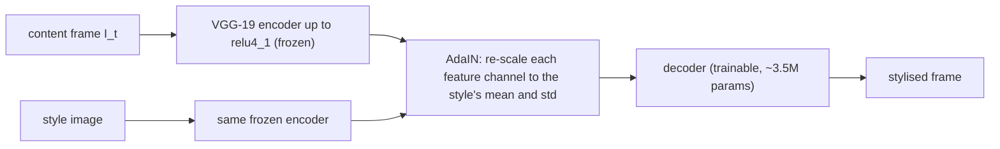
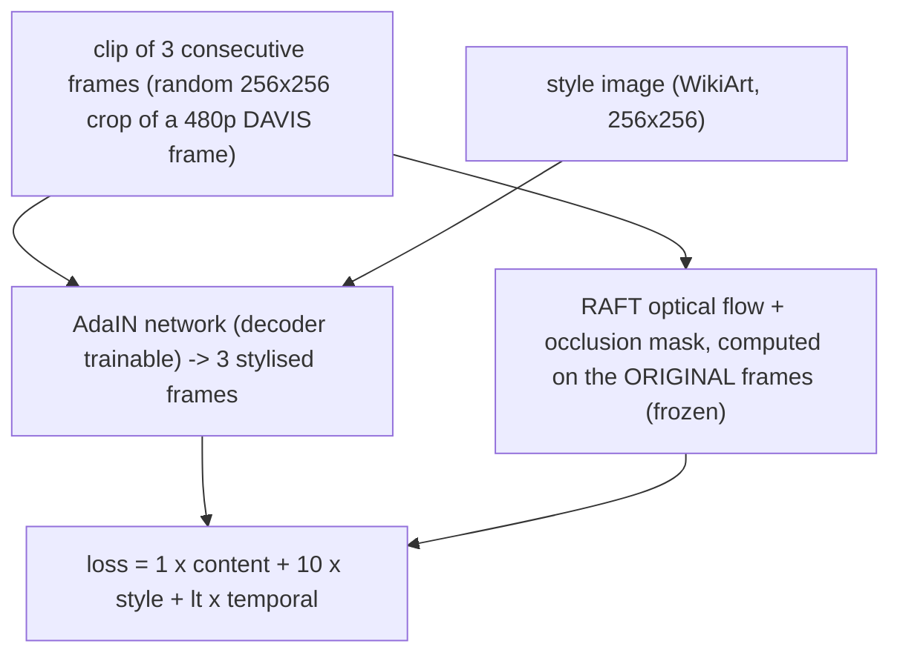
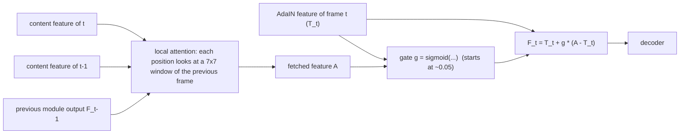

# Method and architecture

Everything here is taken from the code in `src/` (file names in brackets). Results are in [`RESULTS.md`](RESULTS.md); the experiment rules are in [`PROTOCOL.md`](PROTOCOL.md).

## 1. What problem, what idea
Input: a **content video** and **one style image** (any style). Output: the video painted in that style.
Stylising every frame on its own **flickers**, because tiny changes between frames make the network paint slightly different strokes.
We start from a pretrained arbitrary-style model (**AdaIN**) and try to reduce the flicker in three ways:

| id | what it is | extra cost at inference |
|---|---|---|
| **B0** | pretrained AdaIN, every frame independent (baseline) | none |
| **control** | AdaIN decoder fine-tuned on our data with content + style loss only | none |
| **B1** | same fine-tuning **plus a flow-warped temporal loss** (lt = loss weight) | **none** (same network as B0) |
| **B2** | B1 + a small **local-attention fusion module** that looks at the previous frame | small module (+5 ms/frame) |
| **B0 + flow blend** | post-process: mix the current frame with the optical-flow-warped previous output | RAFT optical flow on every frame (~227 ms) |

`control` exists to separate "extra training" from "the temporal loss".

## 2. The base network: AdaIN [`adain.py`]

* Encoder: VGG-19 up to `relu4_1`, weights `vgg_normalised.pth` (the mean/std image normalisation is built into its first 1x1 conv). **Frozen**, also during training.
* AdaIN: `AdaIN(c, s) = (c - mean(c)) / std(c) * std(s) + mean(s)`, mean/std per channel over space.
* Decoder: mirror of the encoder (9 conv layers, 3 nearest-neighbour upsamplings, reflection padding), output = RGB image in [0, 1] (not clamped inside the model).
* Convention used everywhere: images are RGB floats in [0, 1]; frames are reflect-padded to a multiple of 8 and cropped back.

## 3. Training [`train.py`, `data.py`]

* **Data:** 60 DAVIS-2017 training videos x 5,000 WikiArt training styles (525 artists, artist-disjoint from the validation/test styles).
* **Content loss** (as in AdaIN): `MSE( enc(output_t), AdaIN(enc(I_t), enc(S)) )` on relu4_1 features.
* **Style loss** (as in AdaIN): for relu1_1 ... relu4_1, `MSE(mean(enc(output)), mean(enc(S))) + MSE(std(...), std(...))`.
* **Temporal loss (the new part):** for consecutive frames `t-1, t`:
  `L_temp = sum_x M(x) * mean_rgb( output_t(x) - warp(output_{t-1})(x) )^2 / sum_x M(x)`
  where `warp` moves the previous stylised frame onto the current frame with the optical flow `current -> previous` (backward warping), and `M` marks pixels where the flow is reliable
  (inside the frame, forward-backward consistent, not on a motion boundary; Ruder et al. 2016) [`flowutil.py`]. **The flow is always estimated on the original frames, never on stylised ones.**
  Outputs are clamped to [0, 1] before this term.
* **Recipe (identical for every run):** 2000 steps, batch of 4 clips, Adam, learning rate 5e-5 decaying (cosine) to 5e-6, seed 0 (a second run with seed 1 for lt = 150). Only the decoder (and the B2 module) is trained.
* The share of each weighted loss term is logged (`logs/train_*.jsonl`) so no term can silently be negligible. (In the earlier project's fine-tuning the temporal term was ~10^-7 of the total; here it is 17-47%.)
* Temporal weights tried: lt = 150, 500, 1500 (the weight is the smoothness-vs-style knob).

## 4. B2: local attention fusion module [`temporal_module.py`]

* Works at 1/8 resolution on 512-channel features. Queries come from the current content feature, keys from the previous content feature (so the **content** decides where the previous frame matches), values from the module's own previous output (recurrent).
* Window radius 3 (7x7), key dimension 64, value dimension 128, ~0.23M parameters. **No optical flow at inference**; RAFT is only used by the training loss.
* The gate decides per position how much of the fetched feature to use; it is initialised small (about 0.05) so training starts from plain B1 behaviour.
* **Outcome:** no reproducible gain over B1 (the sign of the difference flipped between two seeds, and the gate stayed at about 0.007). It is kept as a documented negative result.

## 5. The inference paths [`methods.py`]
* B0 / control / B1: `encode -> AdaIN -> decode`, frame by frame, no memory of previous frames.
* B2: same, but the AdaIN feature of each frame (except the first) goes through the fusion module first.
* Flow blend: `out_t = (1 - a*M) * raw_t + a*M * warp(out_{t-1})`, with RAFT flow and the same occlusion mask `M`; strength `a` in {0.1 ... 0.6}.

## 6. Metrics [`metrics.py`, `evaluate.py`] (all unit-tested in `tests/test_metrics.py`)
* **Warping error** (temporal consistency, lower = smoother; after Lai et al., ECCV 2018): for frames `t` and `t-k`,
  `E = sum_x M(x) * d(O_t(x), W(O_{t-k})(x)) / sum_x M(x)`, `d` = squared (MSE) or absolute (L1) difference averaged over RGB.
  k = 1 (short term) and k = 5 (long term). Flow: RAFT-Large on the **original** frames; mask `M` as above; outputs are rounded to 8 bit first (what saving a PNG does).
  The **original video** is also scored: that is the floor of the metric (0.00118 for k = 1 on our test videos).
* **Content LPIPS:** LPIPS (AlexNet) between each stylised frame and its own content frame (lower = content better preserved).
* **Style distance:** AdaIN-style mean/std distance between output and style image over relu1_1 ... relu4_1; plus a Gram-matrix distance. These use AdaIN's own VGG, so they favour AdaIN-type models and are **not** a substitute for human judgement.
* Warp error alone can be gamed by blur or ghosting, so everything is read as a trade-off (`results/tradeoff_test.png`).
* **Aggregation:** styles are averaged inside a video, then a bootstrap 95% confidence interval over the 15 test videos (the video is the independent unit). Method differences are paired per video.

## 7. Data splits [`splits/`, `make_style_set.py`]
Videos: DAVIS-2017 train (60) for training; the official validation set (30) split 15 / 15 into **validation** (decisions) and **test** (used once, at the end).
Styles (WikiArt, split by artist): train 5,000 / validation 30 / test 40; evaluation uses 6 evenly spaced styles of the split.
The three styles of the earlier project (Cuphead, Mosaic, Starry Night) are used only for the old-model comparison and qualitative figures.

## 8. Code map
| file | role |
|---|---|
| `src/adain.py` | VGG encoder, decoder, AdaIN operator, padding helpers |
| `src/flowutil.py` | RAFT-Large wrapper, backward warping, occlusion mask |
| `src/data.py` | DAVIS clips and WikiArt styles datasets |
| `src/train.py` | fine-tuning (`--mode control|b1|b2`, `--lt`, `--seed`) |
| `src/temporal_module.py` | B2 module |
| `src/methods.py` | inference wrappers (per-frame, flow blend, B2) |
| `src/metrics.py`, `src/evaluate.py` | metrics and the evaluation CLI with bootstrap summaries |
| `src/eval_external.py`, `src/external_methods.py` | run ReReVST / MCCNet inside our pipeline |
| `src/eval_old_models.py` | the earlier project's per-style TransformerNet models |
| `src/make_report.py`, `src/time_methods.py`, `src/time_external.py`, `src/qualitative.py` | tables, chart, speed, frame figures |
| `tests/test_metrics.py` | synthetic tests of warp / RAFT / mask / metrics |
| `run_*.sh` | the exact job queues that produced the results |

## 9. How to run (Windows / one GPU; Python with torch, torchvision, lpips, opencv)
```bash
# 1) put the pretrained AdaIN weights in weights/ (vgg_normalised.pth, decoder.pth from github.com/naoto0804/pytorch-AdaIN), DAVIS in data/DAVIS, styles in data/styles
python tests/test_metrics.py
# 2) train (examples; see run_queue*.sh for the exact commands)
python src/train.py --mode b1 --name b1_lt150 --lt 150 --steps 2000
python src/train.py --mode b2 --name b2_lt150 --lt 150 --steps 2000
# 3) evaluate trained models (validation split; test only once at the end)
python src/evaluate.py --split val --methods B0 B0+blend0.3 ckpt:b1_lt150:checkpoints/b1_lt150.pt attn:b2_lt150:checkpoints/b2_lt150.pt
```
Trained models are in `checkpoints/` (see the README).

## 10. Known limitations
One base model and one recipe; two seeds only for lt = 150; 6 styles per evaluation; DAVIS videos only; style/content metrics are proxies tied to AdaIN's VGG; no human ratings yet.
Published ReReVST is smoother than everything we trained (see RESULTS.md section 6).
